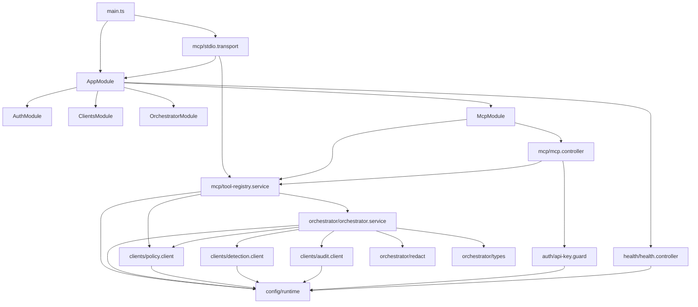
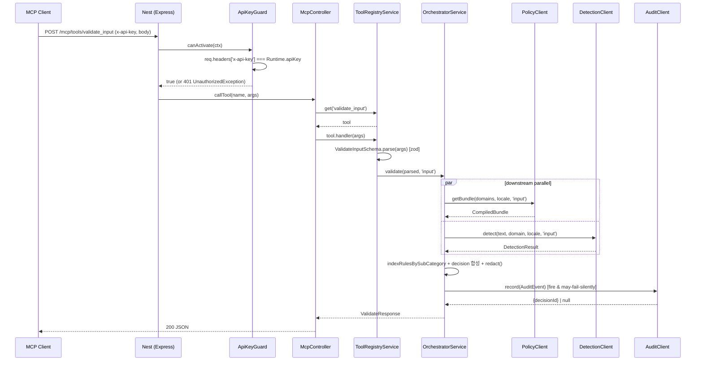
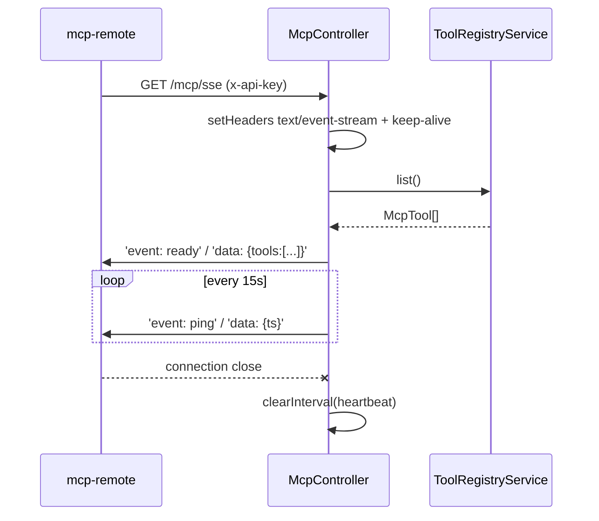

# 코드 단위 리뷰 보고서 / Line-by-Line Code Review

> 분석일: 2026-05-20
> 대상: /Users/wise/Developer/Web(Node,Script)/Guardrails-Service-Server
> 리뷰 레벨: 2 (3년차 주니어 개발자, 인수인계 품질)
> 선택 파일 수: 19 / 19
> 분석: Claude (Anthropic)

본 보고서는 Guardrails Service 의 MCP Server 컴포넌트(NestJS 10 + TypeScript 5.4) 에 대한 Level 2 코드 리뷰다. 모든 소스 파일이 600 LOC 미만이라 라인 단위 분석을 일관되게 적용했다.

---

## 1. 작업공간 인벤토리 / Workspace Inventory

### 1.1 디렉토리 트리 (depth 4, defaults 제외)

```
Guardrails-Service-Server/
├── .dockerignore                       # node_modules/.env/.git 등 빌드 제외
├── .env.example                        # 환경 변수 템플릿 (10줄)
├── .gitignore
├── .omc/                               # (OMC 메타, 분석 대상 외)
├── Dockerfile                          # 2-stage Node 20-alpine
├── README.md                           # 컴포넌트 가이드 (217줄)
├── nest-cli.json                       # Nest CLI 설정
├── package.json                        # deps + scripts + jest config
├── tsconfig.json                       # strict, ES2022, commonjs
└── src/
    ├── app.module.ts                   # 루트 모듈
    ├── main.ts                         # bootstrap, http vs stdio 분기
    ├── auth/
    │   ├── api-key.guard.ts            # x-api-key 검증 Guard
    │   └── auth.module.ts              # Global 모듈
    ├── clients/
    │   ├── audit.client.ts             # → Audit Service
    │   ├── clients.module.ts           # Global 모듈
    │   ├── detection.client.ts         # → Detection Engine
    │   └── policy.client.ts            # → Policy Engine
    ├── config/
    │   └── runtime.ts                  # ENV → 상수
    ├── health/
    │   └── health.controller.ts        # GET /health
    ├── mcp/
    │   ├── mcp.controller.ts           # HTTP/SSE/JSON-RPC endpoint
    │   ├── mcp.module.ts
    │   ├── stdio.transport.ts          # stdin/stdout JSON-RPC 루프
    │   └── tool-registry.service.ts    # 8개 tool 등록 + dispatcher
    └── orchestrator/
        ├── __tests__/
        │   └── redact.spec.ts          # redact 단위 테스트
        ├── orchestrator.module.ts      # Global 모듈
        ├── orchestrator.service.ts     # 핵심 파이프라인
        ├── redact.ts                   # placeholder 치환
        └── types.ts                    # Decision/Validate 타입
```

### 1.2 파일 수 (top-level / 언어별)

| 영역 | 파일 수 | 비고 |
| :-- | --: | :-- |
| `src/` (.ts) | 19 | spec 1개 포함 |
| `src/auth/` | 2 | |
| `src/clients/` | 4 | |
| `src/config/` | 1 | |
| `src/health/` | 1 | |
| `src/mcp/` | 4 | |
| `src/orchestrator/` | 4 (+1 test) | |

확장자별: `.ts` 19개. 그 외 소스 코드 파일은 없음.

### 1.3 빌드/의존성 매니페스트

| 파일 | 버전/주요 항목 |
| :-- | :-- |
| `package.json` | name=`guardrails-mcp-server`, version=0.1.0, NestJS 10.3.x, axios 1.6.8, zod 3.22.4, `@modelcontextprotocol/sdk` ^1.0.0 (선언만, import 없음) |
| `tsconfig.json` | `strict: true`, target=ES2022, module=commonjs, decorators=on |
| `nest-cli.json` | `sourceRoot: src`, `deleteOutDir: true` |
| `Dockerfile` | node:20-alpine 2-stage |
| `.env.example` | 9 vars |

### 1.4 락파일 / Lockfiles

확인 불가 — `package-lock.json`, `yarn.lock`, `pnpm-lock.yaml` 모두 부재. (재현 가능한 빌드를 위해 락파일 커밋 권장 — Step 7 참조)

### 1.5 진입점 후보 / Entrypoints

- `src/main.ts` (bootstrap)
- 분기: `MCP_TRANSPORT=stdio` → `src/mcp/stdio.transport.ts:startStdioTransport()`
- 분기: 그 외 → `NestFactory.create(AppModule)` → `app.listen(PORT)`

### 1.6 테스트 디렉토리 + 러너

- 단위 테스트 1개: `src/orchestrator/__tests__/redact.spec.ts`
- Jest config 는 `package.json` 내 `jest` 블록 (rootDir=src, testRegex=`.*\.spec\.ts$`, ts-jest transform)

---

## 2. 프로젝트 구조 / Project Structure

### 2.1 소스 트리 (역할 노트 포함)

```
src/
├── main.ts                           [bootstrap: stdio/http 분기]
├── app.module.ts                     [루트 NestJS 모듈]
├── auth/
│   ├── api-key.guard.ts              [x-api-key 헤더 == Runtime.apiKey 검증]
│   └── auth.module.ts                [Global 모듈, Guard provider/export]
├── clients/
│   ├── audit.client.ts               [POST /events; 실패 시 silent drop]
│   ├── clients.module.ts             [Global 모듈, 3개 client provider/export]
│   ├── detection.client.ts           [POST /detect, POST /normalize]
│   └── policy.client.ts              [GET /policies/bundle?domains&locale&ioType]
├── config/
│   └── runtime.ts                    [process.env → 정적 상수 객체]
├── health/
│   └── health.controller.ts          [GET /health (no guard)]
├── mcp/
│   ├── mcp.controller.ts             [@Controller('mcp') @UseGuards; 4 endpoints]
│   ├── mcp.module.ts                 [Controller + ToolRegistry provider]
│   ├── stdio.transport.ts            [bootstrap 외부, NL 분리 JSON-RPC 루프]
│   └── tool-registry.service.ts      [8 tools 등록 + zod 검증 + handler]
└── orchestrator/
    ├── __tests__/
    │   └── redact.spec.ts            [redact() 단위 테스트 3개]
    ├── orchestrator.module.ts        [Global 모듈]
    ├── orchestrator.service.ts       [validate/sanitize 파이프라인 (PRD §8.1)]
    ├── redact.ts                     [sub_category → placeholder, R→L 치환]
    └── types.ts                      [Decision union + Request/Response 타입]
```

### 2.2 모듈 의존 그래프 (Mermaid)



핵심 관찰:
- `config/runtime.ts` 가 leaf 의존 (대부분 모듈이 import). 변경 영향이 크다.
- `clients/*`, `orchestrator/*`, `auth/*` 모두 `@Global()` 모듈 — `app.module.ts` 에서 import 만 하면 어디서든 inject 가능.
- `mcp.module.ts` 만 비-Global. (그러나 자체 controller 가 ToolRegistry 를 inject 하므로 외부 노출 필요 없음.)

### 2.3 호출·응답 흐름도 (Mermaid sequenceDiagram)

#### 2.3.1 HTTP transport — `POST /mcp/tools/validate_input`



#### 2.3.2 stdio transport — JSON-RPC `tools/call`

```mermaid
sequenceDiagram
  participant Desk as Claude Desktop
  participant Stdin as process.stdin
  participant Loop as stdio.transport loop
  participant Reg as ToolRegistryService
  participant Orch as OrchestratorService
  participant Stdout as process.stdout

  Desk->>Stdin: '{"jsonrpc":"2.0","id":1,"method":"tools/call","params":{name,arguments}}\n'
  Stdin->>Loop: 'data' event (chunk)
  Loop->>Loop: buf += chunk; split on '\n'
  Loop->>Loop: JSON.parse(line)
  Loop->>Reg: registry.get(name)
  Reg-->>Loop: tool
  Loop->>Orch: tool.handler(arguments)  [via registry handler]
  Orch-->>Loop: result (ValidateResponse)
  Loop->>Stdout: '{"jsonrpc":"2.0","id":1,"result":{"content":[{type:"text",text:JSON.stringify(result)}]}}\n'
  Stdout-->>Desk: line
```

#### 2.3.3 SSE — `GET /mcp/sse`



주의: 현 SSE 는 일방향(서버→클라) 하트비트 placeholder. `tools/call` 결과 스트리밍은 미구현 — README 의 “Full bidirectional SSE requires the upstream MCP SDK” 와 일치한다.

### 2.4 외부 패키지 인벤토리 / Third-party Package Inventory

| 패키지 | 버전 | 사용처 | 역할 | 라이선스 |
| :-- | :-- | :-- | :-- | :-- |
| `@modelcontextprotocol/sdk` | ^1.0.0 | (선언만, import 없음) | MCP SDK — 향후 SSE/full transport | MIT |
| `@nestjs/common` | ^10.3.0 | `app.module.ts`, 모든 service/controller | DI/Module/Guard 데코레이터 | MIT |
| `@nestjs/config` | ^3.2.0 | `app.module.ts` (ConfigModule.forRoot) | .env 로드 | MIT |
| `@nestjs/core` | ^10.3.0 | `main.ts`, `stdio.transport.ts` (NestFactory) | 부트스트랩 | MIT |
| `@nestjs/platform-express` | ^10.3.0 | (간접) `app.listen`, `Response` 타입 | Express adapter | MIT |
| `axios` | ^1.6.8 | `policy/detection/audit.client.ts`, `tool-registry.service.ts` (explain_decision) | HTTP 클라이언트 | MIT |
| `reflect-metadata` | ^0.2.0 | (간접) NestJS 데코레이터 메타 | 리플렉션 | Apache-2.0 |
| `rxjs` | ^7.8.1 | 사용 없음 (NestJS peer) | (간접 peer dep) | Apache-2.0 |
| `zod` | ^3.22.4 | `tool-registry.service.ts` | tool input schema 검증 | MIT |
| **devDeps** | | | | |
| `@nestjs/cli` | ^10.3.0 | `npm run build` (nest build) | 빌드 | MIT |
| `@nestjs/schematics` | ^10.1.0 | nest-cli.json collection | 스캐폴딩 | MIT |
| `@nestjs/testing` | ^10.3.0 | 사용 없음 (테스트 파일이 services 의존 안함) | 테스팅 유틸 | MIT |
| `@types/express` | ^4.17.21 | `mcp.controller.ts`, `api-key.guard.ts` (type Request/Response) | Express 타입 | MIT |
| `@types/jest` | ^29.5.12 | spec.ts | Jest 타입 | MIT |
| `@types/node` | ^20.11.0 | crypto, process | Node 타입 | MIT |
| `jest` | ^29.7.0 | spec.ts | 테스트 러너 | MIT |
| `supertest` | ^6.3.4 | 사용 없음 | HTTP E2E (미작성) | MIT |
| `ts-jest` | ^29.1.2 | jest transform | TS 컴파일 | MIT |
| `ts-node` | ^10.9.2 | 사용 없음 (nest start 가 직접 사용 가능) | TS 런타임 | MIT |
| `typescript` | ^5.4.0 | 빌드 | 컴파일러 | Apache-2.0 |

grep 으로 코드 기반 사용처를 확인했고, `rxjs` / `@nestjs/testing` / `supertest` / `ts-node` / `@modelcontextprotocol/sdk` 는 코드 import 없음 → `사용 없음` 표기. SDK 는 README 가 “follow-up” 으로 명시.

### 2.5 데이터 흐름 · 상태 저장소 / Data Flow & State Stores

- **DB 스키마**: 본 서버는 직접 DB 접근이 없다. 모든 영속화는 Audit Service(HTTP) 위임.
- **캐시/큐**: 없음. (README: M2+ 항목에 “sha256 → 결정 캐시 TTL 60s” 가 향후 작업으로 명시.)
- **설정 소스**: `process.env` 만. `runtime.ts` 가 모듈 로드 시점에 한 번 평가 → 런타임 재로드 없음.
- **I/O 경계**:
  - HTTP 인바운드: Express(8080) — `/health`, `/mcp/tools`, `/mcp/tools/:name`, `/mcp`, `/mcp/sse`
  - stdio 인바운드: `process.stdin` (line-delimited JSON-RPC)
  - HTTP 아웃바운드: Policy(8082)/Detection(8081)/Audit(8083) — axios 인스턴스 3개, timeout (3000/5000/2000 ms)
- **상태 보유**:
  - `ToolRegistryService.tools` (Map) — 생성자에서 한 번 채워지고 mutate 되지 않음.
  - `stdio.transport.ts` 의 `buf` (string) — stdin 청크 누적 버퍼 (line splitting).
  - 그 외는 모두 함수-로컬, stateless.

### 2.6 진입점 목록 / Entrypoints

| # | 경로 | 심볼 | 호출 경로 |
| --: | :-- | :-- | :-- |
| 1 | `src/main.ts` | `bootstrap()` (IIFE) | `node dist/main.js` (Dockerfile CMD) |
| 2 | `src/main.ts` → `src/mcp/stdio.transport.ts` | `startStdioTransport()` | `MCP_TRANSPORT=stdio node dist/main.js` |
| 3 | `src/health/health.controller.ts` | `HealthController#health` | `GET /health` |
| 4 | `src/mcp/mcp.controller.ts` | `McpController#listTools` | `GET /mcp/tools` |
| 5 | `src/mcp/mcp.controller.ts` | `McpController#callTool` | `POST /mcp/tools/:name` |
| 6 | `src/mcp/mcp.controller.ts` | `McpController#jsonRpc` | `POST /mcp` |
| 7 | `src/mcp/mcp.controller.ts` | `McpController#sse` | `GET /mcp/sse` |
| 8 | `src/mcp/stdio.transport.ts` | `dispatch()` | stdin JSON-RPC frame |

---

## 3. 리뷰 파일 선정 / File Selection

### 3.1 선정 기준

- 진입점(`main.ts`, `mcp.controller.ts`, `stdio.transport.ts`) 부터 2-hop 내 모든 파일.
- 전체 파일 19개 < cap 40 → **모두 선택**.
- 600 LOC 초과 파일 없음 → 모두 line-by-line 적용.

### 3.2 Selected Files (19)

| # | 경로 | LOC | 거리(entry-hop) | 리뷰 파일 |
| --: | :-- | --: | --: | :-- |
| 1 | `src/main.ts` | 25 | 0 | [src/main.ts.md](./src/main.ts.md) |
| 2 | `src/app.module.ts` | 19 | 1 | [src/app.module.ts.md](./src/app.module.ts.md) |
| 3 | `src/config/runtime.ts` | 18 | 2 | [src/config/runtime.ts.md](./src/config/runtime.ts.md) |
| 4 | `src/auth/api-key.guard.ts` | 22 | 2 | [src/auth/api-key.guard.ts.md](./src/auth/api-key.guard.ts.md) |
| 5 | `src/auth/auth.module.ts` | 7 | 2 | [src/auth/auth.module.ts.md](./src/auth/auth.module.ts.md) |
| 6 | `src/clients/audit.client.ts` | 41 | 2 | [src/clients/audit.client.ts.md](./src/clients/audit.client.ts.md) |
| 7 | `src/clients/clients.module.ts` | 12 | 2 | [src/clients/clients.module.ts.md](./src/clients/clients.module.ts.md) |
| 8 | `src/clients/detection.client.ts` | 48 | 2 | [src/clients/detection.client.ts.md](./src/clients/detection.client.ts.md) |
| 9 | `src/clients/policy.client.ts` | 59 | 2 | [src/clients/policy.client.ts.md](./src/clients/policy.client.ts.md) |
| 10 | `src/health/health.controller.ts` | 21 | 1 | [src/health/health.controller.ts.md](./src/health/health.controller.ts.md) |
| 11 | `src/mcp/mcp.controller.ts` | 104 | 1 | [src/mcp/mcp.controller.ts.md](./src/mcp/mcp.controller.ts.md) |
| 12 | `src/mcp/mcp.module.ts` | 11 | 1 | [src/mcp/mcp.module.ts.md](./src/mcp/mcp.module.ts.md) |
| 13 | `src/mcp/stdio.transport.ts` | 86 | 1 | [src/mcp/stdio.transport.ts.md](./src/mcp/stdio.transport.ts.md) |
| 14 | `src/mcp/tool-registry.service.ts` | 139 | 2 | [src/mcp/tool-registry.service.ts.md](./src/mcp/tool-registry.service.ts.md) |
| 15 | `src/orchestrator/orchestrator.module.ts` | 7 | 2 | [src/orchestrator/orchestrator.module.ts.md](./src/orchestrator/orchestrator.module.ts.md) |
| 16 | `src/orchestrator/orchestrator.service.ts` | 158 | 3 | [src/orchestrator/orchestrator.service.ts.md](./src/orchestrator/orchestrator.service.ts.md) |
| 17 | `src/orchestrator/redact.ts` | 32 | 3 | [src/orchestrator/redact.ts.md](./src/orchestrator/redact.ts.md) |
| 18 | `src/orchestrator/types.ts` | 32 | 3 | [src/orchestrator/types.ts.md](./src/orchestrator/types.ts.md) |
| 19 | `src/orchestrator/__tests__/redact.spec.ts` | 63 | n/a | [src/orchestrator/__tests__/redact.spec.ts.md](./src/orchestrator/__tests__/redact.spec.ts.md) |

### 3.3 Deferred Files (0)

`--max-files 40` cap 미달, 전부 리뷰. Appendix A 참조.

---

## 4. 종합 분석 / Whole-Codebase Synthesis

### 4.1 반복 패턴 / Recurring Patterns

1. **`@Global()` 모듈 남발** — `AuthModule`, `ClientsModule`, `OrchestratorModule` 모두 `@Global`. 의존성 출처가 모호해진다. 현재 규모는 작지만, M2+ 에서 RBAC/캐시가 추가되면 “어디서 inject 되는지” 추적이 어려워진다. → mcp.module 처럼 명시적 imports 권장.
2. **axios 인스턴스 직접 생성** — `policy/detection/audit.client.ts` 각각 `axios.create()` 호출. interceptor (logging, retry, trace id 전파) 가 하나도 없음. M2+ OpenTelemetry trace 전파 시 일괄 수정 필요.
3. **`Runtime` 정적 import** — `config/runtime.ts` 가 `process.env` 를 **모듈 로드 시 1회** 평가. ConfigModule.forRoot 가 `.env` 를 읽기 *전에* import 되면 default 값으로 고정될 수 있다 (실측 필요). NestJS 의 권장은 `ConfigService.get()` 사용.
4. **에러 핸들링 비대칭** — Audit 는 try/catch 로 swallow, Policy/Detection 은 `.catch(() => null)` 로 fallback, ToolRegistry 의 `explain_decision` 은 catch 없이 throw. 일관된 정책 없음.
5. **`any` 타입 잔존** — `mcp.controller.ts:59 jsonRpc(@Body() body: any)`, `stdio.transport.ts:32 req: any` — 비록 zod 가 handler 안에서 다시 검증하지만, RPC 프레임 자체에 대한 타입은 없다.

### 4.2 계층 위반 / Layering Violations

- **`tool-registry.service.ts:108` 동적 import + axios 직접 호출** — Orchestrator 또는 AuditClient 를 통과해야 할 “explain_decision” 이 client 계층을 우회한다. 베이스 URL 도 `Runtime.auditServiceUrl` 을 그대로 인라인. → `AuditClient` 에 `getEvent(id)` 메서드 추가가 자연스럽다.
- **`tool-registry.service.ts:96`** `ToolRegistry` 가 `PolicyClient` 를 직접 inject — get_policy_bundle 만을 위해서. 작긴 하지만, “tool 등록자가 client 도 안다” 는 흐름은 Orchestrator 단일 책임을 흐린다. (현 규모에서는 허용 가능.)
- **`@Global()` 도배** — 의존 그래프상 leaf 가 다층에서 import 되므로 사실상 계층 위반은 아니지만, 의존 “명시성” 이 약하다.

### 4.3 위험 핫스팟 / Risk Hotspots (top-5)

| 순위 | 파일 | 사유 |
| --: | :-- | :-- |
| 1 | `src/auth/api-key.guard.ts` | 평문 문자열 비교(`!==`) — timing-safe 비교 부재. 또한 `Runtime.apiKey` 의 default 가 `dev-key-please-change` 라 운영 사고 시 무력화. |
| 2 | `src/orchestrator/orchestrator.service.ts` | 외부 호출 2개 병렬 + 결정 합성 + redact + audit — 핵심 경로의 모든 분기/null 처리가 여기에 집중. Locale fallback 누락 시 KeyError 위험(아래 watch-out). |
| 3 | `src/mcp/stdio.transport.ts` | line-buffer accumulation: 비정상 거대 입력 시 OOM. parse 실패 시 buf 초기화 없음. |
| 4 | `src/mcp/mcp.controller.ts` | SSE 가 `req.on('close')` 이 아니라 `res.on('close')` — Express 5/Node 환경에 따라 동작 차. body:any + heartbeat 만 보내고 결과 스트리밍은 없음 (placeholder). |
| 5 | `src/mcp/tool-registry.service.ts` | `inputSchema` 가 zod `.shape` 를 raw object 로 노출 → 실제 JSON Schema 가 아님 (MCP 클라이언트가 introspection 시 깨질 수 있음). |

### 4.4 삭제 후보 / Deletion Candidates

- **`DetectionClient.normalize()` (`detection.client.ts:43-46`)** — grep 결과 코드 내 호출자 없음. 향후 “sanitize 전용 endpoint” 계획이라면 docstring 추가, 아니면 제거.
- **`DetectionMatch.rule_hint`, `Rule.patterns.*` 일부 필드** — 타입 인터페이스에는 있으나 서버 코드에서 사용처 없음 (다운스트림 응답 통과용). 의도된 통과면 주석 권장.
- **devDeps**: `@nestjs/testing`, `supertest`, `ts-node` 는 코드 import 없음. 향후 E2E 작성 예정이면 보존, 아니면 정리.
- **`@modelcontextprotocol/sdk`** dependency — README 가 “M2+” 로 미루지만 dependencies 에 선언됨. devDep 으로 옮기거나 실제 통합 시점까지 빼는 것이 정직하다.

### 4.5 테스트 공백 / Test Gaps

- 단 1개 spec (`redact.spec.ts`). 의존성 모두 mocked 아닌 순수 함수만 테스트.
- **누락된 테스트** (Level 2 인수인계 기준 권고):
  1. `OrchestratorService.validate` — Policy/Detection mock + decision 합성 (`ACTION_TO_DECISION` 매핑, `block` 시 redactedText, audit 실패 시 fallback decisionId, 매치 없는데 detection signal 만 있을 때 input/output 분기).
  2. `ApiKeyGuard` — 헤더 누락/오답/일치 3 케이스.
  3. `ToolRegistryService` — 8개 tool 등록, zod 실패 시 에러 메시지, `get_policy_bundle` 의 domain/domains fallback.
  4. `stdio.transport` — line splitting (단일 청크에 여러 frame, 한 frame 이 청크 경계 가로질러), parse_error 응답.
  5. SSE — 헤더, 첫 'ready' 이벤트, heartbeat clear-on-close.
- e2e: `supertest` 의존성은 있으나 사용 안 함. `/mcp/tools` GET, `POST /mcp` JSON-RPC, x-api-key 401 시나리오 등 최소 3개 권장.

### 4.6 다음 단계 / Next Steps (우선순위 순)

1. **API key 비교를 timing-safe 로** — `crypto.timingSafeEqual(Buffer.from(provided), Buffer.from(Runtime.apiKey))` + 길이 사전 점검. default key 가 `dev-key-please-change` 인 채로 prod 부팅 시 startup hard-fail.
2. **`Runtime` 을 `ConfigService` 로 이관** — 또는 `app.module.ts` 에서 `ConfigModule.forRoot({ load: [runtimeFactory] })` 패턴. ENV 로드 타이밍 안전성 확보.
3. **`OrchestratorService.validate` 의 locale fallback 보강** — `Runtime.enabledLocales[0]` 이 빈 배열(`ENV=,`) 일 때 `'ko-KR'` 로 가지만, `severityRank` 의 `[s]` 가 undefined 면 0. 결정에는 영향 없지만 명시적 default 유지.
4. **stdio buf 안전장치** — buf 길이 상한(예: 1MB) + 초과 시 reset + stderr 로그.
5. **`AuditClient.getEvent(id)` 추가 + `explain_decision` 리팩토링** — 동적 import + 인라인 axios 제거.
6. **lockfile 커밋** — `package-lock.json` 또는 `pnpm-lock.yaml` 누락 → 재현 가능 빌드 불가.
7. **JSON Schema 정합성** — `inputSchema: ZodObject.shape` 는 MCP 명세상 JSON Schema 가 아니다. `zod-to-json-schema` 또는 수동 매핑.
8. **테스트 확장** — 위 4.5 항목 차례로.
9. **`@Global()` 정리** — 도메인이 늘기 전 명시적 imports 로 회귀.
10. **다운스트림 axios interceptor** — request id 전파 + 공통 에러 로깅 + 재시도(정책에 따라).

---

## 5. 부록 / Appendices

### Appendix A — Deferred files

없음. 19개 전부 리뷰 완료.

### Appendix B — Full package inventory

§2.4 참조. 본 프로젝트는 의존성이 적어 본문에 포함했다.

### Appendix C — Glossary

Level 2 기본값으로 생략.

---

## 디렉토리별 개요

- [src/ Abstract](./src_Abstract.md)
- [src/auth/ Abstract](./src/auth/auth_Abstract.md)
- [src/clients/ Abstract](./src/clients/clients_Abstract.md)
- [src/config/ Abstract](./src/config/config_Abstract.md)
- [src/health/ Abstract](./src/health/health_Abstract.md)
- [src/mcp/ Abstract](./src/mcp/mcp_Abstract.md)
- [src/orchestrator/ Abstract](./src/orchestrator/orchestrator_Abstract.md)
